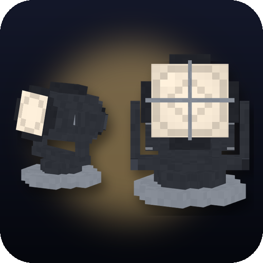
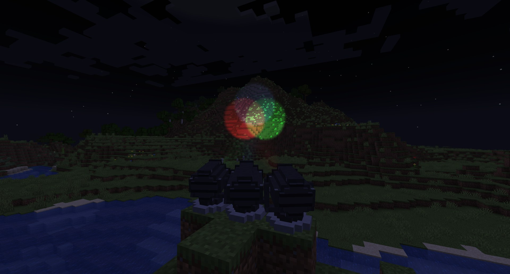

<p align="center">
  
</p>

<h1 align="center">Lumen Rigs</h1>

<p align="center">
  <b>Stage lighting for Minecraft</b> - aimable spotlights, floodlights, searchlights and soft panels with coloured light and visible beams.
</p>

<p align="center">
  <a href="https://www.curseforge.com/minecraft/mc-mods/lumen-rigs"></a>
  <a href="https://www.minecraft.net"></a>
  <a href="https://neoforged.net"></a>
  <a href="https://www.curseforge.com/minecraft/mc-mods/veil-lib"></a>
  <a href="LICENSE"></a>
</p>

<p align="center">
  
</p>

## Features

- 🔦 **Four fixtures on motorized yokes** - a zoomable **Spotlight** (5-45°), a wide **Floodlight** with barn doors, a
  **Searchlight** for the night sky (up to 256 blocks) and a **Soft Light Panel**; floor, wall or ceiling.
- 🌈 **Any colour** - 16 dye colours, a hue slider or warm white; colours mix like light: red and green make yellow.
- ✨ **Visible beams** that show more in rain and under water, with a lens flare when a fixture points at you.
- 💡 **Real light** - with Veil: per-pixel spot and area lights with soft edges and block shadows; without it the mod's
  own light still lights blocks, mobs and players in the beam.
- 🎆 **Light effects** - pulse, strobe or rainbow at any speed; fixtures with the same effect play in step.
- 🎛️ **Settings screen** - aim mode (manual, point, follow, sweep), pan, tilt, beam angle, power, softness, range, beam
  visibility, redstone and effect; copy and paste settings between fixtures.
- 📡 **Lighting Remote** - link fixtures and aim them all at a block, make them follow a mob or player, or shine where
  you look.
- 🔴 **Redstone** - switch with a signal or use its strength as a dimmer.
- 🛡️ **Client-side light** - nothing is placed in the world: safe for servers and other mods, mobs still spawn.

## Controls

| Action | How |
|---|---|
| Open a fixture's settings | *Use* (right click) on it with an empty hand |
| Link / unlink a fixture | *Use* on it with the Lighting Remote |
| Aim linked fixtures at a block | *Use* the remote on the block |
| Follow a mob or player | *Use* the remote on it |
| Shine where you look | *Use* the remote into the air |
| Forget all links | *Sneak* + *Use* the remote into the air |
| Copy a fixture's settings to another | *Copy* in its settings, then *Paste* in the other's |
| Give a fixture's settings to all linked fixtures | Hold the Lighting Remote in your off hand, open the fixture's settings with an empty main hand, press *Apply to linked* |

## Crafting

| Item | Recipe |
|---|---|
| Spotlight | 3 Iron Ingots on top; Iron Ingot, Redstone Lamp, Glass Pane in the middle; Copper Ingot below |
| Floodlight | 3 Iron Ingots on top; 2 Redstone Lamps and a Glass Pane in the middle; Copper Ingot below |
| Searchlight | 3 Iron Ingots on top; 2 Redstone Lamps and Glass in the middle; Iron Block, Copper Ingot, Iron Block below |
| Soft Light Panel (2) | 3 Paper on top; Iron Ingot, Glowstone, Iron Ingot below |
| Lighting Remote | Redstone Torch, Redstone and Iron Ingot in a column |

In creative mode everything is in the **Pocky Mods** tab, the fixtures also in **Functional Blocks** and the remote
in **Tools & Utilities**.

## Configuration

Common config (`config/lumen_rigs-common.toml`, also editable from the in-game mod list):

| Option | Default | |
|---|---|---|
| `remoteRange` | 128 | reach of the Lighting Remote, in blocks |
| `followRange` | 96 | fixtures stop following a target further away than this |

Client config (`config/lumen_rigs-client.toml`):

| Option | Default | |
|---|---|---|
| `beams` | true | draw visible beams |
| `beamStrength` | 1.0 | how visible the beams are |
| `lighting` | true | let fixtures light up blocks and mobs |
| `lightingEngine` | AUTO | `AUTO` uses Veil when installed (and Iris is not), `BLOCK_LIGHT` always uses the built-in light |
| `colorStrength` | 1.0 | how strongly colored light tints what it hits |
| `maxLights` | 48 | how many of the nearest fixtures light up the world at once |

## Compatibility

[](https://www.curseforge.com/minecraft/mc-mods/veil-lib) ✅ **[Veil](https://www.curseforge.com/minecraft/mc-mods/veil-lib)** (optional, recommended) - realistic per-pixel lights, soft cone edges, block shadows and beams scattering in the air.

[](https://modrinth.com/mod/sodium) ✅ **[Sodium](https://modrinth.com/mod/sodium)** - the built-in light works.

[](https://modrinth.com/mod/iris) ✅ **[Iris](https://modrinth.com/mod/iris)** (shader packs) - Veil turns its lights off with Iris, so the built-in light and beams are used.

[](https://www.curseforge.com/minecraft/mc-mods/embeddium) ❌ **[Embeddium](https://www.curseforge.com/minecraft/mc-mods/embeddium)** - its chunk renderer bypasses the built-in light: fixtures and beams show, blocks are not lit.

## Installation

1. Install [NeoForge](https://neoforged.net) for Minecraft 1.21.1.
2. Put this mod into the `mods` folder. For realistic lighting, also add
   [Veil](https://www.curseforge.com/minecraft/mc-mods/veil-lib) (optional).

The mod is needed on both the client and the server.

## Building

```sh
./gradlew build
```

The jar is written to `build/libs/`.

## Credits

- Author: **Pocky**.

<!-- more-mods:start -->
## More mods by Pocky

**🌦️ Weather & nature**

<table>
  <tr>
    <td width="56"><a href="https://www.curseforge.com/minecraft/mc-mods/hoarfrost-snow-blizzards"></a></td>
    <td><a href="https://www.curseforge.com/minecraft/mc-mods/hoarfrost-snow-blizzards"><b>Hoarfrost: Snow & Blizzards</b></a> - seven kinds of snowfall, a living wind and soft snow on the land (<a href="https://github.com/Pocky-l/hoarfrost">source</a>)</td>
  </tr>
  <tr>
    <td width="56"><a href="https://www.curseforge.com/minecraft/mc-mods/petrichor-rain-storms"></a></td>
    <td><a href="https://www.curseforge.com/minecraft/mc-mods/petrichor-rain-storms"><b>Petrichor: Rain & Storms</b></a> - realistic rain, puddles, drips and branching lightning (<a href="https://github.com/Pocky-l/petrichor">source</a>)</td>
  </tr>
  <tr>
    <td width="56"><a href="https://www.curseforge.com/minecraft/mc-mods/rustling-leaves"></a></td>
    <td><a href="https://www.curseforge.com/minecraft/mc-mods/rustling-leaves"><b>Rustling Leaves</b></a> - falling leaves and leaf piles you can wade through, rake and blow away (<a href="https://github.com/Pocky-l/rustling-leaves">source</a>)</td>
  </tr>
</table>

**💡 Light**

<table>
  <tr>
    <td width="56"><a href="https://www.curseforge.com/minecraft/mc-mods/neon-glowsticks"></a></td>
    <td><a href="https://www.curseforge.com/minecraft/mc-mods/neon-glowsticks"><b>Neon Glowsticks</b></a> - throwable glowsticks that bounce, roll and light up the dark (<a href="https://github.com/Pocky-l/neon-glowsticks">source</a>)</td>
  </tr>
</table>

**🎨 Graphics & performance**

<table>
  <tr>
    <td width="56"><a href="https://www.curseforge.com/minecraft/mc-mods/turbo-for-distant-horizons"></a></td>
    <td><a href="https://www.curseforge.com/minecraft/mc-mods/turbo-for-distant-horizons"><b>Turbo for Distant Horizons</b></a> - Distant Horizons terrain generated many times faster (<a href="https://github.com/Pocky-l/dhturbo">source</a>)</td>
  </tr>
  <tr>
    <td width="56"><a href="https://www.curseforge.com/minecraft/mc-mods/pocky-shaders"></a></td>
    <td><a href="https://www.curseforge.com/minecraft/mc-mods/pocky-shaders"><b>Pocky Shaders</b></a> - a cosy, natural shader pack that sets itself up (<a href="https://github.com/Pocky-l/pocky-shaders">source</a>)</td>
  </tr>
</table>

**⚔️ Gear & gameplay**

<table>
  <tr>
    <td width="56"><a href="https://www.curseforge.com/minecraft/mc-mods/holy-staff"></a></td>
    <td><a href="https://www.curseforge.com/minecraft/mc-mods/holy-staff"><b>Holy Staff</b></a> - a healing staff with three skills and flying heal numbers (<a href="https://github.com/Pocky-l/holy-staff">source</a>)</td>
  </tr>
  <tr>
    <td width="56"><a href="https://www.curseforge.com/minecraft/mc-mods/ranchers-vacpack"></a></td>
    <td><a href="https://www.curseforge.com/minecraft/mc-mods/ranchers-vacpack"><b>Rancher's Vacpack</b></a> - a Slime Rancher vacuum gun for items and small mobs (<a href="https://github.com/Pocky-l/ranchers-vacpack">source</a>)</td>
  </tr>
</table>

**🛠️ Server tools**

<table>
  <tr>
    <td width="56"><a href="https://www.curseforge.com/minecraft/mc-mods/inventory-backups"></a></td>
    <td><a href="https://www.curseforge.com/minecraft/mc-mods/inventory-backups"><b>Inventory Backups</b></a> - inventory and ender chest backups with one-click restore for admins (<a href="https://github.com/Pocky-l/inventory-backups">source</a>)</td>
  </tr>
</table>

<!-- more-mods:end -->

## License

[MIT](LICENSE)
